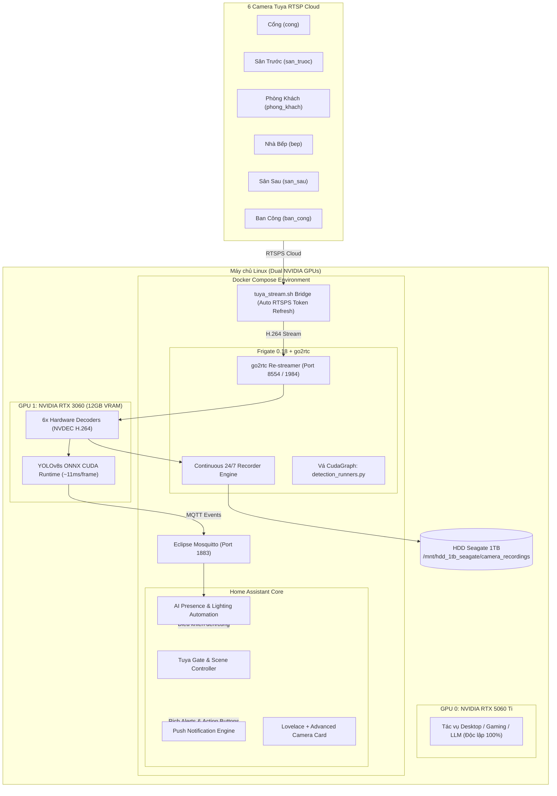

# 🏠 Smart Home & Frigate AI NVR System (Dual-GPU RTX Architecture)

Hệ sinh thái nhà thông minh và giám sát an ninh toàn diện tích hợp **Home Assistant Core**, **Frigate NVR 0.18** (AI Vision Object Detection với **YOLOv8s ONNX CUDA**), **Mosquitto MQTT Broker**, **Tuya Cloud Camera Stream Bridge**, và hệ thống điều khiển tự động hóa đèn & cổng thông minh.

---

## 📑 Mục lục
- [1. Tính năng nổi bật](#1-tính-năng-nổi-bật)
- [2. Kiến trúc hệ thống Dual-GPU](#2-kiến-trúc-hệ-thống-dual-gpu)
- [3. Cấu hình Camera & Luồng dữ liệu](#3-cấu-hình-camera--luồng-dữ-liệu)
- [4. Mô hình AI YOLOv8s & Tối ưu GPU](#4-mô-hình-ai-yolov8s--tối-ưu-gpu)
- [5. Hệ thống Tự động hóa Thông minh (Automations)](#5-hệ-thống-tự-động-hóa-thông-minh-automations)
  - [5.1. Đèn thông minh theo sự hiện diện AI (Smart Presence Lighting)](#51-đèn-thông-minh-theo-sự-hiện-diện-ai-smart-presence-lighting)
  - [5.2. Điều khiển Cổng thông minh & Thông báo đẩy](#52-điều-khiển-cổng-thông-minh--thông-báo-đẩy)
- [6. Lưu trữ 24/7 & Cơ chế cuốn chiếu an toàn](#6-lưu-trữ-247--cơ-chế-cuốn-chiếu-an-toàn)
- [7. Hướng dẫn Cài đặt & Triển khai](#7-hướng-dẫn-cài-đặt--triển-khai)
- [8. Quản lý Vận hành & Lệnh hữu ích](#8-quản-lý-vận-hành--lệnh-hữu-ích)
- [9. Bảo mật & Biến môi trường](#9-bảo-mật--biến-môi-trường)

---

## 1. Tính năng nổi bật

- 🚀 **Kiến trúc Dual-GPU độc lập:**
  - Toàn bộ tác vụ giải mã video phần cứng (NVDEC) và suy luận AI (CUDA) được dồn sang card **NVIDIA GeForce RTX 3060 (12GB VRAM - GPU 1)**.
  - Card chính **RTX 5060 Ti (GPU 0)** được cách ly hoàn toàn, không bị chiếm dụng VRAM/CUDA core, sẵn sàng cho công việc render, đồ họa và AI LLM.
- 🧠 **AI Vision Object Detection với YOLOv8s ONNX:**
  - Nhận diện độ phân giải cao $640\times 640$, tensor định dạng `nchw`.
  - Tốc độ xử lý siêu tốc: **~11.0 ms / frame** trên ONNX CUDAExecutionProvider.
  - Phân loại chính xác tuyệt đối: Người (`person`), Ô tô (`car`), Xe máy (`motorcycle`), Xe đạp (`bicycle`), Chó (`dog`), Mèo (`cat`). Khắc phục triệt để lỗi phân loại nhầm người thành xe đạp của các model cũ.
- 💡 **Tự động hóa Đèn Thông minh theo AI Presence:**
  - Tự động bật đèn khi phát hiện người và tự tắt sau thời gian không còn chuyển động.
  - Phân vùng logic theo ngữ cảnh:
    - **Sân Trước, Phòng Khách, Ban Công**: Chỉ tự động bật khi trời tối (sau hoàng hôn / ban đêm từ 18:00 đến 06:00).
    - **Nhà Bếp, Sân Sau**: Tự động bật 24/7 mỗi khi có người bước vào.
  - Công tắc tổng `input_boolean.smart_lighting_enabled` cho phép bật/tắt toàn bộ tính năng đèn tự động chỉ với 1 chạm.
- 🚪 **Tích hợp Điều khiển Cổng thông minh:**
  - Điều khiển mở/đóng toàn bộ cổng qua switch Tuya (`switch.cong_switch_switch_1`) và mở 1 cánh qua scene Tuya (`scene.mo_1_cong`).
  - Tương thích các nút thao tác nhanh trực tiếp trên thông báo đẩy điện thoại.
- 📲 **Rich Push Notifications (Pixel 10 Pro XL):**
  - Gửi snapshot chất lượng cao kèm clip xem lại ngay khi phát hiện người/vật lạ.
  - Chế độ an ninh ban đêm thông minh cho phòng khách & nhà bếp (23:00 - 05:00).

---

## 2. Kiến trúc hệ thống Dual-GPU



---

## 3. Cấu hình Camera & Luồng dữ liệu

Hệ thống quản lý 6 camera giám sát với thứ tự ưu tiên hiển thị (`ui.order`) tối ưu cho trải nghiệm người dùng:

| Thứ tự | Tên hiển thị | Mã Camera | Độ phân giải | FPS Detect | Hardware Accel | Hành vi tự động hóa |
| :---: | :--- | :--- | :---: | :---: | :---: | :--- |
| **1** | **Cổng** | `cong` | 480 × 544 | 5 | NVDEC (`preset-nvidia-h264`) | Báo xe, người lạ; Nút bấm mở cổng nhanh |
| **2** | **Sân Trước** | `san_truoc` | 640 × 360 | 5 | NVDEC (`preset-nvidia-h264`) | Bật đèn sân (18h-6h); Nút bấm mở cổng |
| **3** | **Phòng Khách** | `phong_khach`| 640 × 360 | 5 | NVDEC (`preset-nvidia-h264`) | Bật đèn khách (18h-6h); Cảnh báo đêm (23h-5h) |
| **4** | **Nhà Bếp** | `bep` | 640 × 720 | 5 | NVDEC (`preset-nvidia-h264`) | Bật đèn bếp 24/7 khi có người; Cảnh báo đêm |
| **5** | **Sân Sau** | `san_sau` | 640 × 360 | 5 | NVDEC (`preset-nvidia-h264`) | Bật đèn sân sau 24/7; Giám sát vật nuôi |
| **6** | **Ban Công** | `ban_cong` | 640 × 360 | 5 | NVDEC (`preset-nvidia-h264`) | Bật đèn ban công (18h-6h); Giám sát tầng lầu |

---

## 4. Mô hình AI YOLOv8s & Tối ưu GPU

### 4.1. Thông số mô hình AI
- **Kiến trúc:** YOLOv8 Small (`yolov8s.onnx`)
- **Kích thước đầu vào:** $640 \times 640 \times 3$ (định dạng `nchw`, `rgb`, kiểu dữ liệu `float32`).
- **Phân loại Frigate:** `model_type: yolo-generic`.
- **Detector:** `type: onnx` trên `CUDAExecutionProvider`.
- **Tốc độ:** **11.0 - 11.8 ms / inference** (so với 45-60 ms của CPU).

### 4.2. File vá tương thích CUDA Graph Runner
Frigate phiên bản 0.18 tự động bật tính năng `CudaGraphRunner` cho các mô hình YOLO generic. Tuy nhiên, các mô hình ONNX xuất từ Ultralytics chứa các toán tử shape động khiến CUDA Graph Capture báo lỗi.
- Giải pháp: File [frigate/detection_runners.py](file:///home/nhotin/work/home/frigate/detection_runners.py) được gắn (volume mount) đè lên `/opt/frigate/frigate/detectors/detection_runners.py`.
- Tác dụng: Bỏ qua ép buộc CUDA Graph đối với `yolo-generic` để fallback an toàn sang `ONNXModelRunner` trên nền CUDA, giữ tốc độ tối đa ~11ms mà không gây crash container.

### 4.3. Cách ly GPU trong Docker Compose
Tránh sử dụng cờ `privileged: true` vì cờ này tự động phơi bày toàn bộ các card đồ họa của máy chủ vào container. Cấu hình chuẩn xác trong `docker-compose.yml`:
```yaml
frigate:
  image: ghcr.io/blakeblackshear/frigate:stable-tensorrt
  network_mode: host
  deploy:
    resources:
      reservations:
        devices:
          - driver: nvidia
            device_ids: ['1'] # Chỉ cấp phát duy nhất GPU 1 (RTX 3060)
            capabilities: [gpu]
  environment:
    - NVIDIA_VISIBLE_DEVICES=1
    - NVIDIA_DRIVER_CAPABILITIES=all
```

---

## 5. Hệ thống Tự động hóa Thông minh (Automations)

### 5.1. Đèn thông minh theo sự hiện diện AI (Smart Presence Lighting)
File cấu hình [config/automations.yaml](file:///home/nhotin/work/home/config/automations.yaml) chứa logic bật/tắt tự động:
- **Công tắc kích hoạt chung:** `input_boolean.smart_lighting_enabled` (tạo trong `config/configuration.yaml`).
- **Logic bật đèn (`smart_presence_lighting_turn_on`):**
  - Khi `binary_sensor.<khu_vuc>_person_occupancy` chuyển sang `on`:
    - **Sân Trước**: Bật `switch.san_truoc_switch_1` và `switch.san_truoc_switch_3` nếu trời tối (`sun.sun == below_horizon` hoặc giờ $\ge 18$ hoặc $< 6$).
    - **Phòng Khách**: Bật `switch.phong_khach_switch_2` nếu trời tối.
    - **Ban Công**: Bật `switch.ban_cong_switch_1` nếu trời tối.
    - **Nhà Bếp**: Bật `switch.nha_bep_switch_2` và `switch.nha_bep_switch_3` bất kể ngày/đêm.
    - **Sân Sau**: Bật `switch.san_sau_switch_switch_1` bất kể ngày/đêm.
- **Logic tắt đèn (`smart_presence_lighting_turn_off`):**
  - Tự động tắt sau **2 phút** không còn người đối với: Sân Trước, Sân Sau, Ban Công.
  - Tự động tắt sau **5 phút** không còn người đối với: Phòng Khách, Nhà Bếp.

### 5.2. Điều khiển Cổng thông minh & Thông báo đẩy
- Khi phát hiện người hoặc xe tại Cổng / Sân Trước:
  - Bắn thông báo kèm ảnh snapshot tới `notify.mobile_app_pixel_10_pro_xl`.
  - Nút **Mở/Đóng cổng**: Kích hoạt `switch.cong_switch_switch_1` (bật 1 giây rồi tự tắt giả lập nút bấm xung).
  - Nút **Mở 1 cánh**: Kích hoạt scene Tuya `scene.mo_1_cong`.
  - Nút **Xem clip**: Mở trực tiếp video sự kiện trên Frigate.

---

## 6. Lưu trữ 24/7 & Cơ chế cuốn chiếu an toàn

- **Ổ cứng chuyên dụng:** Seagate 1TB gắn tại `/mnt/hdd_1tb_seagate/camera_recordings`.
- **Mức tiêu hao dung lượng:** ~**23.5 GB / ngày** cho cả 6 luồng camera H.264.
- **Chính sách lưu trữ (`retain.days: 30`):**
  - Toàn bộ video ghi hình liên tục 24/7 và clip sự kiện được lưu trữ tối thiểu **30 ngày gần nhất** (~700 - 750 GB).
  - Tự động cuốn chiếu xóa các đoạn video cũ nhất khi sang ngày mới, luôn bảo toàn 20-30% dung lượng trống cho ổ cứng.

---

## 7. Hướng dẫn Cài đặt & Triển khai

### 7.1. Chuẩn bị môi trường
1. Cài đặt Docker & Docker Compose Plugin.
2. Cài đặt NVIDIA Container Toolkit để hỗ trợ GPU pass-through:
   ```bash
   nvidia-ctk runtime configure --runtime=docker
   sudo systemctl restart docker
   ```
3. Kiểm tra GPU ID:
   ```bash
   nvidia-smi --query-gpu=index,name,uuid --format=csv
   ```
   *(Đảm bảo card RTX 3060 tương ứng với device ID `1`)*.

### 7.2. Tải mã nguồn & Cấu hình biến môi trường
1. Clone repository:
   ```bash
   git clone https://github.com/nhotin/smarthome.git
   cd smarthome
   ```
2. Khởi tạo file cấu hình `.env`:
   ```bash
   cp .env.example .env
   nano .env
   ```
   *(Điền thông tin tài khoản Tuya Cloud, MQTT, HA Tokens)*.

3. Tải model YOLOv8s ONNX (nếu chưa có):
   ```bash
   mkdir -p frigate/config/model_cache
   curl -L -o frigate/config/model_cache/yolov8s.onnx https://github.com/blakeblackshear/frigate/raw/master/docker/tensorrt/detector/yolov8s.onnx
   ```

### 7.3. Khởi động hệ thống
```bash
docker compose up -d
```

---

## 8. Quản lý Vận hành & Lệnh hữu ích

### 8.1. Kiểm tra trạng thái dịch vụ & GPU
- Xem trạng thái các container:
  ```bash
  docker compose ps
  ```
- Kiểm tra tiến trình sử dụng GPU RTX 3060:
  ```bash
  nvidia-smi -i 1
  ```
  *(Bạn sẽ thấy các tiến trình `ffmpeg` và tiến trình suy luận ONNX xuất hiện tại GPU 1; GPU 0 vẫn hoàn toàn trống tải camera)*.

### 8.2. Xem nhật ký hoạt động (Logs)
- Xem log Frigate NVR:
  ```bash
  docker compose logs -f --tail=100 frigate
  ```
- Xem log Home Assistant:
  ```bash
  docker compose logs -f --tail=100 homeassistant
  ```
- Kiểm tra tốc độ suy luận AI (Inference Speed):
  ```bash
  curl -s http://127.0.0.1:5000/api/stats | jq '.detectors'
  ```

---

## 9. Bảo mật & Biến môi trường

> [!IMPORTANT]
> Dự án được thiết kế an toàn để lưu trữ công khai trên Git:
> - Toàn bộ các thông tin nhạy cảm (Access ID, Secret, Password, IP cá nhân) được quản lý qua biến môi trường `.env`.
> - File [.gitignore](file:///.gitignore) đã chặn tất cả các file cơ sở dữ liệu SQLite (`*.db`), log, token cá nhân và thư mục `.storage/`.
> - Tuyệt đối không commit file `.env` lên GitHub.
